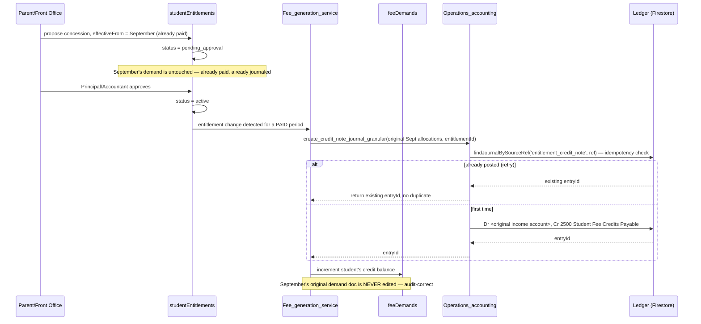
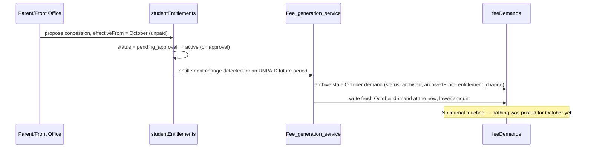
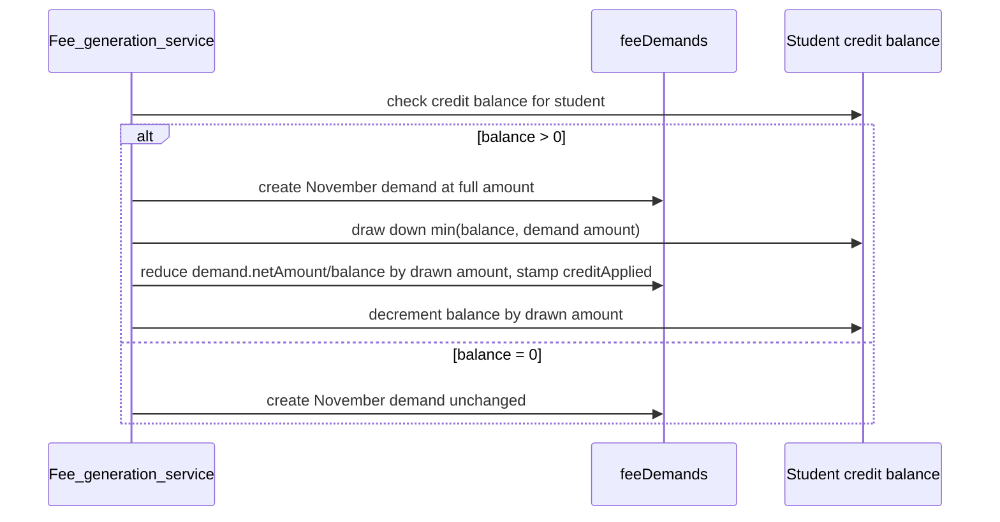

# Student Entitlements — Frozen Architecture Baseline

**Status:** **APPROVED — this is the canonical, frozen architecture, as of 2026-08-08.** No further architectural redesign unless a verified Critical production issue requires it. All PENDING markers were resolved with citations before approval. One finding surfaced during verification was more severe than anything in the original adversarial review — see the callout immediately below.

> **NEW, most severe finding of this entire Phase 0 pass: a Cloud Function races against the PHP fee generator and can silently create duplicate, un-discounted demand documents.** `functions/fee_generation_worker.js::processFeeGenerationJob` is Firestore-triggered on `fee_generation_jobs/{jobId}` creation — which happens automatically on *every* fee-structure save and every "Generate Demands" click. It runs independently of, and races against, the synchronous PHP worker the same request already invoked. The Cloud Function (a) applies **zero discounts of any kind** (`discount_amount: 0` is hardcoded) and (b) uses a **different, deterministic doc-ID scheme** than the PHP path's random IDs — so if it wins the race, it does not overwrite the PHP-generated doc, it creates a **second, separate, full-gross-amount demand document** for the same student/period/fee-head. Whether the CF or PHP wins in practice is not determinable from static code — it depends on Firestore trigger latency versus the PHP request's own timing, verified only by observing it live. This is now **G12**, and closing it (decide: retire the Cloud Function entirely, or make it concession-aware and doc-ID-compatible with the PHP path) is a **Phase 0A blocking item**, not a Phase C nice-to-have — full detail in §0A.5.
**Once complete and approved, this document is the frozen architecture.** No further redesign after approval, except in response to a Critical production issue discovered during implementation.
**Date:** 2026-08-07
**Supersedes for implementation purposes:** `ADMISSION_SERVICES_AND_EXEMPTIONS_RESEARCH_AND_DESIGN.md` (original design) and `STUDENT_ENTITLEMENTS_FINAL_ARCHITECTURE_REVIEW.md` (adversarial review that opened this Phase 0). Both remain as historical record; this document is where their open questions get closed with evidence.

---

## Reframing, before anything else

Two Phase-0 findings change how this whole project should be understood, and both are good news:

1. **This is not a new architecture competing with the old one — it's the completion of one that was already half-built.** `Fee_concession_reader.php` and `Fee_service_enrollment_reader.php` already exist, with docblocks that describe a Phase 1 → Phase 2 → Phase 3 rollout: Phase 1 built dated, windowed, effective-window-matched reader classes for both concessions and services; Phase 2 (confirmed live, `USE_UNIFIED_FEE_GEN=true`) cut concessions over to them; Phase 3 (not started) was always meant to cut services over the same way. The entitlement log this project proposes **is Phase 3**, generalized to also unify concessions' three other parallel mechanisms. The effective-window matching logic (`effectiveFrom`/`effectiveTo` overlap against a `periodKey`) this document needs already exists, twice, nearly identically, and is already correct.
2. **Most of the accounting machinery Phase 0B needs already exists too.** `Operations_accounting.php` already has a properly double-entry, concession-aware granular journal builder (`_buildGranularLines`, with a full contra-revenue chart-of-accounts mapping for 8 concession types) and a symmetric, idempotent, per-account granular refund/reversal journal (`create_refund_journal_granular`, keyed by `findJournalBySourceRef`). The gap is narrower than originally scoped — see §Phase 0B.

The rest of this document proceeds phase by phase, per the required scope.

---

## Phase 0A — Billing Engine Verification

### 0A.1 — The actual fee-generation model (PROVEN, not inferred)

**Full trace, `application/libraries/Fee_lifecycle.php` (947 lines, read in its entirety):**

`Sis.php` calls `Fee_lifecycle::assignInitialFees($studentId, $class, $section, $parentDbKey)` at exactly three call sites — `Sis.php:641` (path 3, direct admission), `Sis.php:4357` (context: bulk operation, see §0A.4), `Sis.php:7419` (paths 1/2, CRM enrolment). `assignInitialFees` (`Fee_lifecycle.php:354-402`) is a thin wrapper: it calls `_routedBuildAdmissionSpecs()`, and if specs were built, commits them via `commitDemandBatch()` (one atomic batched write, falling back to per-doc writes on batch failure) in a **single call**.

`_routedBuildAdmissionSpecs()` (`Fee_lifecycle.php:328-352`) is a pure router: if `USE_UNIFIED_FEE_GEN` is true (confirmed true in `application/config/fees_exemption_v2_flags.php`), it delegates to `Fee_generation_service::generateDemandsForStudent()`; otherwise it calls `buildAdmissionDemandSpecs()` directly. **Either path ultimately calls `buildAdmissionDemandSpecs()`** — `Fee_generation_service` (127 lines, read in full) does not itself enumerate periods; it consumes the spec list `buildAdmissionDemandSpecs()` produces and applies concession deductions to each entry (see §0A.4).

**`buildAdmissionDemandSpecs()` (`Fee_lifecycle.php:201-320`) is where the period model lives, and it is unambiguous:**

```php
foreach ($chart as $monthOrYearly => $heads) {          // $chart = the FULL class fee structure
    foreach ($heads as $headName => $amount) {
        $targetMonths = $isYearly ? ['April'] : [$monthOrYearly];
        foreach ($targetMonths as $m) {
            // ... writes ONE demand doc for this (student, head, month)
        }
    }
}
```

This loops over **every month present in the school's fee chart for that class** (`feeStructures`), and writes one `feeDemands` document per fee-head per month, **in a single function call**, at admission time. There is no month-by-month recurrence — the entire year's calendar of demands is created in one pass.

**Critically — and this is a new finding beyond what the adversarial review flagged — there is no join-date filter of any kind inside this loop.** A private helper, `_remainingAcademicMonths(int $joinMonth)` (`Fee_lifecycle.php:910-919`), computes exactly the "months remaining in the session" value that *would* be needed to prorate a mid-year admission — but it is used **only inside `proRateFees()`** (`Fee_lifecycle.php:544-589`), which is called **only from `Transport_service.php`** (three call sites: `:2650`, `:2693`, `:2873` — `assignStudent`, `unassignStudent`, `changeRoute`), confirmed by `grep -rn "proRateFees\|->assignInitialFees(" application/controllers/*.php application/libraries/*.php` returning zero hits for `proRateFees` inside `Sis.php` or any other controller.

**Finding, stated precisely: a student admitted in October is billed `feeDemands` documents for April through March in full — including six months that predate their enrolment — with no proration applied anywhere in the tuition-billing path.** This is a genuine, previously undocumented financial-correctness defect, distinct from and additional to G1/G2 (the transport-proration bug already identified). Logged below as **G11**.

### 0A.2 — Regeneration strategy (required because generation is confirmed whole-calendar/one-shot)

Because `buildAdmissionDemandSpecs()` runs once and produces the full calendar, the entitlement log cannot rely on "the generator will naturally not see a closed entitlement next month" (the original design's §5.2 framing) — there is no "next month" invocation to rely on. The regeneration strategy is therefore explicit, and — importantly — **it is not new engineering; it is the exact pattern `reassignFeesOnPromotion` already uses, extended to a narrower trigger.**

**The proven precedent, read in full (`Fee_lifecycle.php:415-533`):** on promotion, every **unpaid** demand for the old class is archived (`status: 'archived'`, `archivedAt`, `archivedBy`, `archivedFrom` — never deleted); every **paid/partial** demand is left untouched (payment history is sacred); then `assignInitialFees` is called fresh for the new class. A fail-loud guard logs an error (not silent) if the regeneration produces zero demands. This is exactly the shape the entitlement-log regeneration needs.

**Regeneration algorithm (this document's canonical definition — replaces the original design's §5.2):**

1. **Trigger:** any `studentEntitlements` write that moves an entitlement to `active` or closes it (`effectiveTo` set) for a period range that overlaps periods **already generated** for that student.
2. **Which demands are regenerated:** only those with `status IN ('unpaid')`, `periodKey >= today's periodKey` (or the entitlement's `effectiveFrom`, whichever is later), and belonging to the fee head(s)/category the entitlement affects. This mirrors the promotion archive filter exactly (`status !== 'unpaid'` → skip, per `Fee_lifecycle.php:437-440`).
3. **Which remain untouched:** anything `paid` or `partial` (payment history, per the codebase's own stated invariant at `Fee_lifecycle.php:22-24`'s status vocabulary comment — "partial/paid... not written here; payment flow sets it" — nothing outside the payment flow may touch these), and anything with `periodKey < today` (historical, immutable).
4. **How unpaid future periods are rebuilt:** archive the stale unpaid demand docs (same `status: 'archived'`, `archivedFrom: 'entitlement_change'`, `archivedBy`, timestamp — reusing the exact field shape `reassignFeesOnPromotion` writes), then re-invoke `buildAdmissionDemandSpecs`-equivalent generation for the remaining periods only, now reading the updated `studentEntitlements` state. This is a **new, narrower entry point** — not a re-run of full-calendar generation, but the same builder logic bounded to `periodKey >= trigger date`.
5. **How historical periods remain immutable:** by construction (step 2/3's filter) — a period that already has a `paid`/`partial` demand is never touched by regeneration. If a **retroactive** change needs to reach an already-paid period, that is explicitly **not** regeneration — it is the credit-note path (§Phase 0B).
6. **Rollback:** archived demand docs are never deleted, so rollback of a bad regeneration is: un-archive the stale docs (`status: 'unpaid'` restored) and archive/discard the newly-generated ones — symmetric, because both operations use the same `commitDemandBatch` primitive already proven in `assignInitialFees`/`reassignFeesOnPromotion`.
7. **Transaction boundaries:** the archive-batch and the generate-batch are two separate `commitDemandBatch` calls today in `reassignFeesOnPromotion` (not one atomic transaction spanning both) — this is the existing codebase's own precedent, and this document adopts the same boundary rather than introducing a new all-or-nothing transaction, because (a) `commitDemandBatch` already has its own fallback-to-per-doc-write safety net proven in production, and (b) a partial failure here (archived-but-not-yet-regenerated) is self-healing the same way `reassignFeesOnPromotion`'s fail-loud guard already handles a destination-structure-missing failure: it logs at error level and leaves the student in a detectable, auditable state rather than a silently wrong one.

### 0A.3 — Promotion verified (PROVEN)

`reassignFeesOnPromotion()` (`Fee_lifecycle.php:415-533`, read in full) calls `assignInitialFees()` directly at line 469. Since `assignInitialFees` routes through `_routedBuildAdmissionSpecs` → the unified, concession-aware generator (when the flag is on, which it is), **promotion already inherits concession-aware billing automatically today.** No redesign needed here — confirmed, not assumed. Once Phase C/D route service entitlements (transport/hostel) through the same generator, promotion inherits that too, for free, by the same mechanism. This should be stated as an explicit **acceptance criterion** (§Acceptance Criteria) rather than left to be discovered.

### 0A.4 — Every billing path — convergence status (VERIFIED, complete)

The picture is materially larger than the original design assumed. There are not two or three generation mechanisms — there are **nine**, in three disjoint families that share no code with each other.

| # | Path | Mechanism | Discount source | Converges with `Fee_lifecycle`? |
|---|---|---|---|---|
| 1 | **Admission** (all 3 pathways) | `assignInitialFees` → `_routedBuildAdmissionSpecs` | `studentConcessions` (via `Fee_concession_reader`, when flag on) | **Family A — canonical** |
| 2 | **Promotion** | `reassignFeesOnPromotion` → `assignInitialFees` | Same as #1, confirmed §0A.3 | **Family A** |
| 3 | **Transport / Hostel module fee** | `createModuleFee()` | None | **Family A, but not chart/concession-aware** — this is exactly what Phase D unifies |
| 4 | **Single-student manual generation** | `Fees.php::generate_demands_for_student()` (`Fees.php:5085-5159`) | `_getStudentDiscounts()` → `scholarshipAwards` + student-doc `exemptedFees`/`discountHeads` | **Family B — divergent** |
| 5 | **Bulk "Generate Demands"** | `Fees.php::generate_monthly_demands()` → `_processGenerationJob()` (`Fees.php:5190-5326`) | Same as #4 | **Family B** |
| 6 | **Auto-generation on fee-structure save** | `Fees.php::save_updated_fees()` → same `_processGenerationJob()` as #5 (`Fees.php:1441-1548`) | Same as #4 | **Family B** |
| 7 | **Delete-and-regenerate after a new discount** | `Fees.php::recalc_unpaid_discounts()` (`Fees.php:1676-1754`) | Same as #4 | **Family B** |
| 8 | **Patch existing unpaid demands (no new docs)** | `Fees.php::_recalculateStudentUnpaidDemands()`/`recalculate_demands()` (`Fees.php:6840-6996`) — has its own explicit guard: *"never recompute a concession demand from the legacy studentDiscounts map — it would zero the concession and OVERCHARGE the student"* | Same as #4 | **Family B** |
| 9 | **Cloud Function shadow-generator** | `functions/fee_generation_worker.js::processFeeGenerationJob`, Firestore-triggered on the same `fee_generation_jobs` doc #5/#6 create | **None — hardcoded zero** | **Family C — races against A and B, see §0A.5** |

(A tenth, `Fees.php::compute_fines_for_student()`/`auto_compute_fines()`, only *patches* `fine_amount`/`balance` on existing demands and correctly reads the already-net `net_amount` field — respects whatever discount was already applied, does not diverge, not counted above as a generation mechanism.)

**Three fully disjoint discount sources feed these nine mechanisms**, confirmed by code, not inference: `studentConcessions` (Family A only), `scholarshipAwards` + student-doc `exemptedFees`/`discountHeads` (Family B, all six sub-mechanisms), and **nothing at all** (Family C). A student can simultaneously have an active `studentConcessions` record the admission path already honored, a `scholarshipAwards` record only the manual "Generate Demands" screen would ever see, and — if the Cloud Function wins a race — a duplicate demand document with neither applied. This is the single clearest, most concrete piece of evidence for why this project exists, now stated as a fact rather than a design justification.

**Cron/scheduler verdict: definitively NO.** `scripts/cron.txt` documents exactly two scheduled jobs (`reconcile`, `integrity`, via `scripts/run_scheduled.php`) — both confirmed, by reading their full source, to be reconciliation/audit-only (they rewrite `feeDefaulters` projections and check integrity; **neither ever calls `writeDemand` or creates a `feeDemands` document**). `application/controllers/FeeWorker.php` is a CLI worker for the `feeJobs` payment-posting queue — it updates `paidAmount`/`balance` on existing demands, never creates new ones. No `.github` workflow, no cron-prefixed route family for fees exists anywhere in `application/config/routes.php`. §0A.1's working assumption is now a confirmed fact.

### 0A.5 — The Cloud Function shadow-generator, in full (G12)

`functions/fee_generation_worker.js` exports `processFeeGenerationJob` (`functions/index.js:546`), an `onDocumentCreated` trigger on `fee_generation_jobs/{jobId}` (`fee_generation_worker.js:286-293`). Every `fee_generation_jobs` document created by the PHP admin panel — which happens **automatically** on every fee-structure save (#6 above) and every click of the bulk "Generate Demands" button (#5 above) — also fires this Cloud Function, independently and concurrently with the synchronous PHP worker (`_processGenerationJob`) the same HTTP request already ran inline.

**The two paths have a race, with a claim mechanism that reduces but does not eliminate the risk:**
- The Cloud Function has an atomic transactional claim (`fee_generation_worker.js:307-322`) that flips the job's `status: pending → running`. If PHP's own (non-transactional) status flip (`Fees.php:5395`) lands first, the CF's claim fails and it correctly no-ops.
- **Whether PHP or the CF wins is a function of Firestore trigger propagation latency versus the PHP request's own execution time — not determinable from reading the code, and not guaranteed to be consistent request-to-request or region-to-region.**
- **If the CF wins:** its own generator, `buildDemandsForStudent` (`fee_generation_worker.js:169-236`), writes demands with (a) `discount_amount: 0` hardcoded — no discount, concession, or scholarship of any kind is ever applied — and (b) a **deterministic** doc ID (`{schoolId}_{session}_{studentId}_{periodKey}_{feeHeadSlug}`) that is **structurally different** from the PHP path's random `bin2hex(random_bytes(10))` ID (`Fee_firestore_txn.php:1063-1066`). Because the ID schemes don't match, the CF's write does not merge with or overwrite whatever PHP would have written — it creates a **second, separate demand document** for the same conceptual (student, period, fee-head), at full gross amount, alongside whatever PHP already wrote or will write. The existing `periodKey|canonicalFeeHeadId` dedup guard (`Fee_lifecycle.php:278-284`, and Family B's own dedup keys) can catch this on a **subsequent** generation run, but does nothing to prevent the duplicate from existing in the interim — and a family could be shown, or charged against, the wrong one before that happens.

**This must be closed before Phase A, not deferred to Phase C/D.** Two options, both viable, decision needed:
1. **Retire the Cloud Function entirely** — if `_processGenerationJob`'s synchronous PHP path is sufficient for current scale (nothing in this Phase 0 pass found evidence the async CF path is load-bearing for any current feature), delete the trigger and the `fee_generation_jobs` collection's role shrinks to a plain job-status log PHP writes to unconditionally.
2. **Make the Cloud Function concession-aware and doc-ID-compatible** — read `studentConcessions` (or, post-Phase-C, `studentEntitlements`) inside `buildDemandsForStudent`, and switch its ID scheme to match `Fee_firestore_txn`'s exactly, so a race produces an idempotent overwrite instead of a duplicate.

Option 1 is the lower-risk, lower-effort choice unless there's a scale reason (documented nowhere found in this pass) that the synchronous PHP path can't handle bulk generation for very large schools — worth confirming with whoever added the Cloud Function originally, if reachable, before deciding.

---

## Phase 0B — Accounting Verification

### 0B.1 — What already exists (confirmed by full read of `Operations_accounting.php`, 1,851 lines)

Journals post **at payment/collection time, not at demand-generation time** — confirmed by an exhaustive search (`create_fee_journal` has zero call sites in `Fee_lifecycle.php`; its only callers are `Fee_management.php`, `Admission_public.php`, `Admission_collection.php`, `FeeWorker.php`, `AccountingReconciler.php`, `AccountingSimulator.php`). This means unpaid demands can be freely archived/regenerated (§0A.2) with zero accounting exposure — nothing has been journaled for them yet.

**A concession-aware, proper double-entry journal already exists.** `_buildGranularLines()` (`Operations_accounting.php:1284-1568`), invoked by `_create_fee_journal_v2` whenever a payment's allocations carry a `concessions[]` array, does the textbook-correct thing: income is recognized at **gross**, and each concession is posted as its own **Dr contra-revenue line**, resolved via `_resolveConcessionAccount()` (`:1195-1240`) — which already has a full chart-of-accounts keyword-mapping table for **8 concession categories** (merit/scholarship → `4991`, need-based → `4992`, sibling → `4993`, staff → `4994`, transport concession → `4995`, hostel concession → `4996`, government/RTE/EWS/waiver → `4997`, disability → `4998`), with an explicit-mapping override and a generic-fallback (`4990`) below that. This is gated behind a `concessions_enabled` config flag specifically so a school with no concession accounts configured yet gets byte-identical legacy output — the same backward-compatibility discipline this whole project should follow.

**A symmetric, idempotent, granular refund/reversal journal already exists.** `create_refund_journal_granular()` (`Operations_accounting.php:1726-1850`) reverses **exactly** the accounts a payment originally credited — a transport collection reversed via the transport account, not a generic fee-income line — and is idempotent by a generic primitive, `findJournalBySourceRef(source, sourceRef)` (`Accounting_firestore_sync.php:328`), already used with `source='fee_refund'`. Calling it twice with the same `refund_id` returns the existing journal instead of double-posting — confirmed by reading the idempotency guard directly (`Operations_accounting.php:1747-1753`).

### 0B.2 — The one genuinely new piece: a credit balance, not a cash refund

`create_refund_journal_granular()` assumes the reversal ends in **`Cr Cash/Bank`** — money physically leaving the school's account. That's correct for an actual refund request, but **wrong for a retroactive concession**: if a family paid September in full and an RTE/EWS concession is approved in October effective from September, the school does not hand cash back — it owes the family a **credit against a future demand**.

**Confirmed by exhaustive search: no credit-balance / advance-received / student-wallet concept exists anywhere in this codebase today** (`grep -rln "creditBalance|credit_balance|advanceReceived|advance_received|studentWallet|student_wallet|feeCredit|fee_credit"` across all of `application/` — zero matches). This is the one piece of new accounting machinery this project actually needs to build — everything else in §0B.1 is reuse.

**Canonical design:**

- New chart-of-accounts entry: a liability account, **`2500` — Student Fee Credits Payable** (or the nearest free code in the existing `2xxx` liability range — no `2xxx` codes were found defined in the accounts referenced by `Operations_accounting.php`, so this is a clean addition, not a collision).
- New function, `create_credit_note_journal_granular()`, modeled **directly** on `create_refund_journal_granular()` — same per-account reversal-of-original-credit logic, same `findJournalBySourceRef`-based idempotency (new source key: `'entitlement_credit_note'`, `sourceRef = entitlementId . '_' . period`), but the final line is `Cr 2500 (Student Fee Credits Payable)` instead of `Cr Cash/Bank`.
- New field on the student's ledger context (or a small new collection — see §Data Model): a running **credit balance**, incremented when a credit-note journal posts, decremented when a future demand is generated and the generator finds an available credit balance to draw down against it.
- **Draw-down rule:** at generation time (regeneration or normal), if a student has a non-zero credit balance and a new unpaid demand is about to be created, the generator reduces that demand's `netAmount`/`balance` by the smaller of (credit balance, demand amount), decrements the credit balance by the same, and records the draw-down as a line on the demand doc (`creditApplied: {amount, sourceEntitlementId}`) — auditable, not silent.

### 0B.3 — Complete financial-behavior model (all required flows)

| Flow | Mechanism | Status |
|---|---|---|
| **Retroactive concession before payment** | Regeneration (§0A.2) — the affected unpaid demand is archived and regenerated at the new (lower) amount. No journal exists yet, nothing to reverse. | Reuse — no new machinery |
| **Retroactive concession after payment** | New credit-note journal (§0B.2): `Dr <original income account>` (matching what §0B.1's `_buildGranularLines` credited), `Cr 2500 Student Fee Credits Payable`. Credit balance incremented; drawn down against the student's next generated demand. | **New** — the one genuinely new piece |
| **Refund** (family wants cash back, not a credit) | `create_refund_journal_granular()` — already exists, already correct, already idempotent | Reuse, unchanged |
| **Credit balance draw-down** | §0B.2's generator-time rule | New, but small — one conditional at generation time |
| **Future adjustment** (entitlement changes going forward, nothing retroactive) | Regeneration (§0A.2) | Reuse |
| **Government receivable (RTE/EWS)** | New `govtReceivable: {amountExpected, status, lastFollowUp}` sub-object on the `rte_ews`-type entitlement (per the original design, retained) — tracked separately from the parent-facing credit/demand system entirely; it is money owed **to** the school **by government**, not a parent-facing balance | New, small, additive — no accounting-engine change, just a tracked object reported on separately |
| **Ledger posting** | Existing `create_journal`/`_create_journal_v2` (`Operations_accounting.php:261,336`) — the credit-note journal is one more caller of the existing hardened commit path (period-lock check, idempotency claim, atomic CAS batch, retry-on-contention — all already proven, per `_create_fee_journal_v2`'s docblock) | Reuse |
| **Journal reversal** | `create_refund_journal_granular` (refund case) / new `create_credit_note_journal_granular` (credit case) — both are reversals of the **same original granular allocation set**, differing only in the credit-side account | Reuse + one new function following the identical shape |
| **Receivable offset** | The `govtReceivable` sub-object's `status` transitions (`pending → claimed → received`) are advisory bookkeeping on the entitlement doc itself in this phase — no automatic ledger offset is built (matches the original design's explicit "what I would NOT build" scope: no government-facing reconciliation module this phase) | Deferred, by design, unchanged from original scope |

### 0B.4 — Sequence diagrams

**Retroactive concession approved AFTER the period was already paid (the credit-note path):**



**Same scenario, but the affected period was NOT yet paid (the regeneration path, no accounting involved):**



**Credit balance drawn down against a future demand:**



---

## Phase 0C — Data Architecture Verification

### 0C.1 — Firestore index budget

**Resolved — not a blocker.** Current repo state: **257 composite indexes** (`grep -c '"collectionGroup"' firebase-rules/firestore.indexes.json`). Public Firestore documentation confirms the limit is **200 composite indexes per database without billing enabled, 1,000 with billing enabled.** A project already at 257 must already have billing enabled (a free-tier project could not be serving production traffic at 257 indexes in the first place) — so the effective ceiling is 1,000, and this project is at roughly 26% of that budget. The two new indexes this design needs (§Data Model) are not a risk. **H3 from the adversarial review is downgraded from "must verify before Phase B" to "confirmed fine."**

Sources: [Firestore quotas](https://firebase.google.com/docs/firestore/quotas), [Google Developer forum confirming the 200/1,000 split](https://discuss.google.dev/t/youve-reached-your-limit-of-200-composite-indexes-in-firestore/141091).

### 0C.2 — Transaction boundaries

Covered in §0A.2 point 7 — archive-batch and generate-batch are two sequential `commitDemandBatch` calls, matching the existing `reassignFeesOnPromotion` precedent, not a single spanning transaction. Credit-note journal posting (§0B) reuses the existing hardened `_create_journal_v2` commit path (period-lock + idempotency claim + atomic CAS batch + contention retry) unchanged.

### 0C.3 — Atomic student + entitlement creation (H4 from the adversarial review)

Confirmed still needed: path 3 (`save_admission`, no `crmApplications` staging doc) creates the `students` doc directly. **New invariant I6, retained from the review:** student-doc creation and any initial entitlement writes for that admission commit as one atomic unit (Firestore transaction or `commitDemandBatch`-style batch with per-doc fallback, matching the pattern already proven throughout `Fee_lifecycle.php`) or not at all.

### 0C.4 — Denormalized snapshots (H2 from the adversarial review)

Retained: `feeDemands` gains `entitlementRefs: [entitlementId, ...]` and `netEffect: {gross, deductions: [{entitlementId, kind, amount}], net}`, plus (new, from §0B.2) `creditApplied: {amount, sourceEntitlementId}|null` where a credit balance was drawn down. Stamped at generation time — an audit-correct snapshot of what applied *when generated*, not a live join.

### 0C.5 — Concession stacking rule (H5 from the adversarial review)

Retained and now made precise, consistent with `_buildGranularLines`'s existing per-allocation `concessions[]` array shape (which already supports **multiple** concessions per fee-head line, each independently resolved to its own contra account — i.e., the accounting engine already assumes stacking is possible): percent-type entitlements stack **additively**, clamped so combined deduction never exceeds the gross amount (net floor = 0); `fullExempt` always wins outright regardless of what else is active; fixed-amount entitlements stack additively in rupees, same floor. New invariant **I7**.

### 0C.6 — Entitlement lifecycle: deletion, TC, promotion, session rollover

| Event | Existing precedent (verified) | Entitlement-log extension |
|---|---|---|
| **Student soft-delete** | `freezeFeesOnSoftDelete()` already wired at two call sites in `Sis.php` (`:1992`, `:5357`) — freezes all non-paid/archived demands, leaves paid history alone | Extend the same two call sites to also set any `active`/`pending_approval` entitlement to `discontinued` (mirroring the freeze, not a delete) |
| **Transfer Certificate issuance** | `issue_tc()` (`Sis.php:1556+`) already gates on outstanding dues via `_check_outstanding_dues()` — confirmed by reading the function; blocks issuance unless dues are cleared or explicitly overridden | **Gap, confirmed real:** no evidence issue_tc() discontinues active service entitlements (transport/hostel) after a TC is issued — a departed student would keep occupying a route seat / hostel room in capacity counts indefinitely. New requirement: TC issuance discontinues all active service entitlements for that student, same pattern as soft-delete |
| **Promotion** | `reassignFeesOnPromotion` archives unpaid old-class demands, regenerates new-class demands via `assignInitialFees` — confirmed §0A.3 | Entitlements are **student-scoped, not class-scoped** — they survive promotion unchanged by default (a sibling discount doesn't vanish because a child moved to Class 7). Since promotion already routes through the same unified generator, this requires no extra code — only an explicit acceptance criterion confirming it, so nobody "fixes" it into class-scoping by accident |
| **Session rollover** | `cancelSessionDemands()` exists but is **Transport-only** by its own docblock and confirmed call sites (`Transport_service.php`, plus verifier/probe tooling) — core tuition demands have no rollover-cancellation mechanism, and don't need one (each new session's demands come from a fresh `assignInitialFees` call at the start of that session, via promotion) | Service entitlements (transport/hostel) should follow the same `cancelSessionDemands` pattern already proven for Transport — extend it to Hostel (currently Transport-only) rather than inventing a second mechanism |

---

## Phase 0D — Cross-System Verification (VERIFIED, complete)

| Module | Verdict |
|---|---|
| **Document Studio** | Does not exist as a distinct module under this or any plausible alternate name (verified against the directory listing, not just grep). The only document/letter-generation surfaces are the Canonical Document Service (admission uploads, out of scope) and `Certificates.php`. Nothing to couple. |
| **Certificates.php** | Clean — exhaustive grep for `fee\|concession\|discount\|entitlement\|due\|clearance\|outstanding\|balance` across the whole 692-line file returns zero matches. Its `'transfer'` certificate type is a plain templated letter, gated by nothing. |
| **The real TC-issuance coupling — a different code path entirely** | `Sis.php`'s own TC system (`issue_tc`, `print_tc`, `tc_list` — **not** `Certificates.php`) blocks TC printing on outstanding dues: `print_tc()` (`Sis.php:1702`) loads a `block_tc` policy from `feeSettings`, and if enabled, calls `Fee_defaulter_check::calculateClearanceStatus()`, which queries `feeDemands` **three separate times** — once excluding Hostel/Transport categories, once `WHERE category=='Hostel'`, once `WHERE category=='Transport'` (`Fee_defaulter_check.php:586-722`) — plus `libraryIssues`/`libraryFines`. **This is the real "no-dues certificate" gate, and it infers "is this student on transport/hostel" implicitly from the presence of a `category`-tagged `feeDemands` row, not from any dedicated entitlement collection.** Whatever generates Hostel/Transport demands post-Phase-D must keep writing the same `category` field this check already depends on, or TC issuance breaks silently for students on those services. |
| **Communication** | Real fee-reading code exists — `Communication_helper::sendFeeReminder()` (`Communication_helper.php:659-712`) genuinely queries `feeDemands` and sums real dues before firing a `fee_due` event; `sendDefaulterAlert`/`sendFeePaymentConfirmation` similarly real. **But none of the three are called from any production controller** — only from a self-test (`Communication_verifier.php`). `Fees.php::_notify_fee_received()` (`Fees.php:265-278`) also exists but has zero call sites — dead code. **Verdict: designed but currently inert.** Treat as a latent capability the new design should remain compatible with (since it clearly has UI + event-type support already built and looks intended for future activation), not as zero risk. |
| **Student Profile** (`Sis::profile()`→`student_profile()`, `Sis.php:700,5472-5540`, read in full) | Shows exactly three fee-adjacent things: the `studentDiscounts` doc's `totalDiscount`/`onDemandDiscount`, the student doc's embedded `exemptedFees` array, and raw fee-structure totals via `_getFees()`. **Does not read `studentConcessions`, dues/balance, or anything entitlement-shaped at all.** If `studentEntitlements` is meant to replace `studentDiscounts`/`exemptedFees` as the concession source of truth (which this baseline proposes), this function is a direct reader that needs updating in the same phase, or the profile page will show stale numbers next to the new entitlement-driven billing. |
| **Parent App** (`FeesViewModel.kt`/`FeesScreen.kt`/`FeeFirestoreRepository.kt`/`FeeData.kt`) | Reads `feeDemands` directly. **Favorable finding:** the app's `FeeOverview` model already carries `scholarshipAmount`, `carryForwardDues`, `transportFee`, `hostelFee`, `clearanceStatus` fields, and the UI already has a dedicated "Discounts & Adjustments" tab (`FeesScreen.kt:2265-2340`) with an explicit empty-state string — *"Scholarships, fee concessions and previous-year balances will appear here when applicable."* A `netEffect`/`entitlementRefs` field on `feeDemands` slots into UI that already exists. **But:** `scholarshipAmount` today is sourced from a **third, independent collection**, `scholarshipAwards`, queried directly by the app (`FeeFirestoreRepository.kt:306-319`) — not from `studentDiscounts` or `studentConcessions`. This is a fourth discount-reading pathway beyond the three already found server-side (§0A.4), and needs reconciling in the same migration, not treated as separately owned "app-side" work. Also confirms: `ClearanceStatus` in the app (`FeeData.kt:369-411`) is a direct mirror of `Sis.php`'s `Fee_defaulter_check::calculateClearanceStatus()` output — the same `studentClearance` doc, the same TC-gate dependency flagged above. |
| **Teacher App** (`FeeRepository.kt`/`FeeDefaulterDoc.kt`) | Confirmed precisely, not just accepted: reads only `feeDefaulters` — `totalDues` (a single number), `unpaidMonths` (a list of month strings), `examBlocked`, `resultWithheld`. **Zero fee-head breakdown, zero concession/discount/scholarship field anywhere in the app's fee code.** This is the one surface across the whole system with no existing plumbing to extend — a future entitlement breakdown here is net-new work, not a slot-in. |
| **Student 360** | Does not exist anywhere in this codebase — exhaustive grep, zero matches, confirmed independently twice now (adversarial review and this pass). Closest analog: `Sis::student_profile()` above. Any future consolidated view must read entitlements through the single canonical `Fee_entitlement_reader` (§Data Model) — never a bespoke query — the actual mechanism for "no duplicate reads, no duplicate business logic, one source of truth." |

---

## Architecture

**Concept, retained from the original design, now reframed per this document's opening section:** this is Phase 3 of the already-in-progress Fees Exemption v2 rollout, generalized. One collection, `studentEntitlements`, replaces `studentServiceEnrollments` (dead), extends `studentConcessions` (Phase 2, keep the shape), and retires `feeDiscountPolicies`/`studentDiscounts`/`feeScholarships`/`scholarshipAwards` (migrate) and the already-dead `students.exemptedFees`/`discountHeads` fields.

**RBAC, corrected per the adversarial review's H1:** `Entitlements:edit` (propose, shared across all kinds) / `Entitlements:manage` (approve — **concessions only**). Service (transport/hostel) approval continues to route through the existing `Transport:manage`/`Hostel:manage` capabilities, which are already capacity-aware and already held by the right people. This is a correction to the original design, adopted here as final.

**RBAC principle for any future orchestrating surface (Student 360, named explicitly because it's coming — see the dedicated section below):** authorization is never re-decided at the orchestrating layer. A "manage transport" button on Student 360 is visible/enabled by checking the exact same `Transport:manage` capability `Transport.php`'s own screen checks, and clicking it calls the exact same guarded function — never a coarser "Student360:manage" permission and never a duplicate authorization check with its own logic. This is already how `Document_service.php` works today (multiple controllers call it, none re-implement its guards) and is adopted as the standing rule for every module Student 360 will eventually touch.

## Data Model

```
studentEntitlements/{schoolId}_{studentId}_{seq}
├── kind:              'service' | 'concession' | 'credit_note'
├── serviceType:        transport|hostel|meals|null
├── concessionType:     sibling|staff_ward|rte_ews|scholarship|other|null
├── scope:              'all' | 'category:<cat>' | 'head:<feeHeadId>'
│                         — 'all' NEVER includes transport/meals unless explicitly widened
├── valueType:           percent|fixed|fullExempt|amountDue
├── value:               number
├── frequency:           monthly|annual   — REQUIRED, no default (I1)
├── effectiveFrom:        date
├── effectiveTo:          date|null
├── status:              proposed|pending_approval|active|rejected|discontinued
├── approvalRequired:     bool
├── approvedBy/At:        string|null, timestamp|null
├── requestedBy/At:       string, timestamp
├── reason:               string
├── govtReceivable:       {amountExpected, status, lastFollowUp}|null   (RTE/EWS only)
├── linkedRouteId/roomId: string|null
├── creditBalanceRef:     string|null    (kind=credit_note only — links to the ledger journal)
└── auditRef:             auto — every write appends to auditLogs
```

**New, from this Phase 0 pass:**

```
studentFeeCredits/{schoolId}_{studentId}
├── balance:              number   — current undrawn credit
├── history:               [{entitlementId, amount, journalEntryId, createdAt}]
└── updatedAt:             timestamp
```

`feeDemands` gains (additive, non-breaking): `entitlementRefs: [entitlementId,...]`, `netEffect: {gross, deductions:[...], net}`, `creditApplied: {amount, sourceEntitlementId}|null`.

Chart of accounts gains one liability account: `2500 — Student Fee Credits Payable`.

## Firestore Collections

`studentEntitlements` (new), `studentFeeCredits` (new), `feeDemands` (additive fields only, shape otherwise unchanged), `auditLogs` (existing, every entitlement/credit write appends). Composite indexes: `studentEntitlements × (schoolId, studentId, status)`, `studentEntitlements × (schoolId, status, requestedAt)` (approval queue, sorted by request age per the adversarial review's M2, not by `effectiveFrom`). `studentFeeCredits` needs no composite index — deterministic doc-id fetch only.

## APIs

**Read side:** `Fee_entitlement_reader` (new, merging `Fee_concession_reader` + `Fee_service_enrollment_reader` — both retained internally, or their logic folded in; either way, one reader class is the only sanctioned read path for "what is this student's entitlement state"). `Operations_accounting::create_credit_note_journal_granular()` (new, modeled on `create_refund_journal_granular`). A new generation-time draw-down step inside `Fee_generation_service`/`buildAdmissionDemandSpecs`'s successor.

**Write side — new, and load-bearing for §Student 360 Readiness Review below:** entitlement mutations (`propose`/`approve`/`reject`/`discontinue`) are implemented **once**, as a new `Entitlement_service` class, called identically by every surface that can create or change an entitlement — the admission wizard (Phase E), Transport's assign/suspend screen, Hostel's allocation screen, and (later, unbuilt now) Student 360. This is not a new pattern — it mirrors `Document_service.php`'s already-proven shape (`upload/replace/link/unlink/delete/verify`, already called identically by multiple controllers, confirmed clean by inspection) exactly. **No controller is permitted to write to `studentEntitlements` directly** — every write goes through `Entitlement_service`, the same discipline `Fee_lifecycle.php` already enforces for `feeDemands` (every mutation goes through `Fee_firestore_txn`, never a raw `firestoreSet` from a controller).

**New, read-only, cross-module aggregation:** `Student_timeline_reader` — see §Student 360 Readiness Review point 6 for why this exists and exactly what it does and does not do.

## Transactions

Per §0A.2 point 7 and §0C.2 — archive-then-generate as two sequential batched commits, matching the existing `reassignFeesOnPromotion` precedent; credit-note journals through the existing hardened `_create_journal_v2` path unchanged.

## Accounting Rules

Per §Phase 0B in full — reuse the existing concession-aware granular journal and refund-reversal journal; add exactly one new function (`create_credit_note_journal_granular`) and one new liability account (`2500`).

## Fee-Generation Rules

Per §0A.2's regeneration algorithm — the canonical replacement for the original design's §5.2.

## Migration Strategy

Retained from the original design (§5.7): import-first for concessions (dry-run mapping, never silent), greenfield for services. Phase C's "A/B against legacy" is explicitly a **read-only shadow comparison** (per the adversarial review's M1) — the new generator runs and its output is diffed against legacy without persisting the "B" side twice.

**Extended, per §0A.4/§0D's full findings — four discount sources converge into `studentEntitlements`, not two:**
1. `studentConcessions` (Family A, already live) — direct carry-over, compatible shape.
2. `scholarshipAwards` + student-doc `exemptedFees`/`discountHeads` (Family B, six sub-mechanisms in `Fees.php`) — dry-run mapped, same discipline as concessions.
3. `feeDiscountPolicies`/`studentDiscounts` — dry-run mapped.
4. **`scholarshipAwards` read a second time, independently, by the Parent App** (`FeeFirestoreRepository.kt:306-319`) — this is not a second server-side source (same collection as #2), but it means the Parent App's own client code needs updating in the same migration wave that retires server-side reads of `scholarshipAwards`, or the app will keep showing a number the backend no longer produces the same way. Sequence this as part of Phase E's app-side work, not left implicit.

**Family B (`Fees.php`'s six sub-mechanisms) and the Cloud Function (G12) both need an explicit migration decision, not just Family A/legacy-discount migration:** Family B's six functions either need to be individually re-pointed at the unified generator, or explicitly retired with their routes removed — "leave them running against the old discount sources forever" is not an acceptable end state, since it permanently preserves the exact divergence this project exists to close. The Cloud Function is resolved per §0A.5 (retire or rebuild) before Phase A, independent of the rest of this migration.

## Rollback Strategy

Per-phase, per the adversarial review's production-safety table — retained as final, not restated here in full (see that document). The one addition from this Phase 0 pass: regeneration's own rollback (§0A.2 point 6) is symmetric and uses the same batch primitive as the forward operation, so it needs no separate rollback machinery to build.

## Acceptance Criteria (consolidated)

- AC1: A student admitted mid-session is billed only from their actual join date forward, on all three admission pathways (closes G11).
- AC2: Suspending or removing a transport assignment stops future billing in the same generation cycle it's actioned (closes G1/G2).
- AC3: Promotion continues to produce concession-aware demands with zero additional code, verified by test (confirms §0A.3, not just assumed).
- AC4: A concession approved after a period is paid produces a credit-note journal, never a silent demand edit, and the credit is visibly drawn down against the next generated demand.
- AC5: No entitlement can move `pending_approval → active` without `approvedBy` set (I5, retained).
- AC6: `scope:'all'` concessions never net against transport/hostel/meal fee lines (I3, retained).
- AC7: TC issuance and student soft-delete both discontinue active service entitlements, not just freeze fee demands.
- AC8: A student's active entitlements are readable through exactly one function (`Fee_entitlement_reader`) — no second, independently-written query against `studentEntitlements` exists anywhere in the codebase post-migration, **including inside the Cloud Function** (§0A.5) and **inside the Parent App** (currently reads `scholarshipAwards` directly).
- AC9: **No duplicate `feeDemands` document can exist for the same (student, period, fee-head) regardless of which of the nine mechanisms in §0A.4 last touched it** — closes G12. Either the Cloud Function is retired, or its doc-ID scheme and dedup logic match the PHP path exactly.
- AC10: All six Family-B (`Fees.php`) sub-mechanisms either read from the same entitlement source as Family A, or are explicitly retired with their routes removed — no sub-mechanism is left permanently reading a source the rest of the system no longer treats as authoritative.
- AC11: `Sis::student_profile()` and the Parent App's fee breakdown both reflect `studentEntitlements` as the concession source of truth — neither shows a number computed from a retired collection.
- AC12: The TC-issuance dues check (`Fee_defaulter_check::calculateClearanceStatus`) continues to correctly identify Hostel/Transport dues after Phase D — verified by test, since it depends on the `category` field on `feeDemands` continuing to be populated the same way.
- AC13: Path 3 (direct Admission) charges the admission fee by default, through the same resolver paths 1/2 use (closes G10). The "Waive Admission Fee" override is gated by its own distinct RBAC check — a user without that specific grant cannot waive the fee even if they hold every other admission-related permission — and every waive produces an audit entry with actor, student, and stated reason. No waive is possible without a reason recorded.
- AC14: Every operation in §Performance & Scalability Budget's numeric table is measured (not estimated) against its budget before a phase is considered complete — an admission that issues more than the specified round-trips, a `Student_timeline_reader` call that fans out sequentially instead of in parallel, or an `Action_registry::resolveFor()` call that triggers even one Firestore read of its own, each fails this criterion regardless of functional correctness elsewhere in the same change.

## Regression Suite

Must include: reproduction of G1/G2 (pre- and post-fix), reproduction of G11 (pre- and post-fix — new, add it), **reproduction of the G12 race condition, then a test proving the retired trigger no longer fires** (per the resolved decision, retirement is the path, not rebuild) — the promotion-inherits-concessions test (AC3), the paid-then-concessioned credit-note test (AC4) end to end including the ledger entries it produces, a concurrency test on simultaneous entitlement writes for the same student+service, a migration dry-run idempotency test (re-running the import tool twice produces no duplicate entitlements), a TC-issuance dues-check regression test (AC12) covering a student with an active transport or hostel entitlement, and **the admission-fee waive-override test (AC13)** — a user holding every admission permission except the waive grant must be unable to waive, and every successful waive must produce a retrievable audit entry.

## Release Gates

The 8 release gates from the project's standing policy apply to every phase. **Gate 8 (performance) is fully specified in §Performance & Scalability Budget below — the numeric table there is the literal pass/fail criterion, not a general reminder to "watch performance."** **G12 (the Cloud Function race) is a release gate on Phase A itself — Phase A may not be considered complete until G12 is closed, independent of and prior to G1/G2's fixes**, since G12 can corrupt data in a way G1/G2 cannot (a phantom duplicate document, not merely a missed billing adjustment).

---

# Student 360 Readiness Review

**Mandatory per operator directive, 2026-08-07.** Student Entitlements is not being built as an isolated backend project. The current `Sis::student_profile()` page will eventually be replaced by **Student 360** — not a read-only profile, but the primary *operational workspace* for a student: view lifecycle, and **perform actions** across services, concessions, transport, hostel, documents, communication, attendance, fees, accounting-adjacent actions, plus audit history, approvals, and timeline, all from one place. Student 360 is not being built now. This review exists so nothing decided in Phase 0 forces a redesign when it is.

**The standing rule, stated once, that everything below follows from:** *Student 360 orchestrates and presents. It never becomes a database. It never becomes a business-logic layer. Every write it performs is a call to a function some other module already owns and already guards; every number it shows is a read of something some other module already computed.* Where Phase 0's own design decisions didn't already satisfy this, they were changed in this pass, not merely flagged — see the API section above (`Entitlement_service`, `Student_timeline_reader`) for what was added specifically because of this review.

### 1. How Student 360 will consume Student Entitlements

Through `Fee_entitlement_reader` only — the same reader `Fee_generation_service` uses internally, and the same one this document already designates as the sole sanctioned read path (§Phase 0D, Student 360 paragraph; §Data Model). Student 360 calls `activeEntitlementsForStudent(studentId)` / `pendingApprovalsForStudent(studentId)` and renders the result — it does not filter, recompute, or reinterpret entitlement state itself. Writes (propose/approve/reject/discontinue) go through the new `Entitlement_service` (§APIs) — the same functions the admission wizard and the Transport/Hostel screens call. Student 360 is a fourth caller of code that already exists for three other callers, not a fifth implementation.

### 2. Which APIs Student 360 will use

| Domain | API | Status |
|---|---|---|
| Entitlements (read) | `Fee_entitlement_reader` | New in this Phase 0 |
| Entitlements (write) | `Entitlement_service` (propose/approve/reject/discontinue) | New in this Phase 0, added specifically for this review |
| Fee demands / breakdown | `feeDemands` docs directly, reading the denormalized `netEffect`/`entitlementRefs`/`creditApplied` fields (§0C.4) | Existing shape, extended in this Phase 0 |
| Credit balance | `studentFeeCredits` reads + `Operations_accounting::create_credit_note_journal_granular()` for any action that changes it | New in this Phase 0 |
| Documents | `Document_service` (`upload/replace/link/unlink/delete/verify/getMetadata`) | **Already exists, already clean** — confirmed by inspection (§Phase 0D). Student 360 calls it as-is |
| Transport / Hostel | `Transport_service`, `Hostel`'s allocation functions | Already exist. Student 360 calls the same assign/suspend/discontinue functions the dedicated screens call — no new API needed once Phase D routes them through `Entitlement_service` for the billing side |
| Communication | `Communication_helper` (`fire_event`, `sendFeeReminder`, etc.) | Already exists, **but confirmed dormant in production today** (§Phase 0D) — Student 360 will be among the first live callers; this is a dependency to sequence, not a redesign |
| Attendance | Attendance module's own existing read/write functions | Not independently re-verified line-by-line in this Phase 0 pass (out of this project's scope) — **flagged for confirmation before Student 360 implementation begins**, not a blocker now |
| Accounting-adjacent student actions | `Operations_accounting`'s existing granular journal functions, called the same way `Fees.php`/`Admission_collection` already call them | Already exists |
| Audit / timeline | `Student_timeline_reader` (new — see point 6) | New in this Phase 0, added specifically for this review |

### 3. Which Firestore collections Student 360 will read

Never directly, with one narrow exception. Student 360 reads through the reader/service layer above, which reads: `studentEntitlements`, `studentFeeCredits`, `feeDemands`, `students`, plus whatever `Document_service`/`Transport_service`/`Hostel`/`Communication_helper`/Attendance's own functions already read internally (their collections are their own business, not Student 360's). The one exception is `Student_timeline_reader`'s own fan-out (point 6) — necessarily a read-only, cross-collection scan, because timeline aggregation is inherently cross-cutting and no single owning service exists for "everything that happened to this student."

### 4. Which operations will be performed directly from Student 360

Every "manage X" action listed in the operator's brief maps to an existing or planned canonical function, never a new one written for Student 360 specifically: propose/approve/discontinue an entitlement (`Entitlement_service`), assign/suspend a transport route or hostel room (`Transport_service`/`Hostel`, same functions their own screens call), upload/verify/replace/delete a document (`Document_service`, unchanged), send a communication (`Communication_helper::fire_event`, unchanged), record an attendance override (Attendance's own function, to be confirmed), collect a fee payment or record a manual accounting adjustment (`Operations_accounting`'s existing functions). **Student 360 introduces zero new business logic in this list** — it introduces one new UI surface over already-existing or already-planned canonical operations.

### 5. Which modules remain the source of truth

Every domain keeps its own collection and its own writer, unchanged by Student 360's existence: `feeDemands` for what's billed (Fee_lifecycle/Fee_generation_service), `studentEntitlements`/`studentFeeCredits` for services/concessions/credit (this project), documents (Canonical Document Service), transport/hostel assignments (`Transport_service`/`Hostel`), communication delivery (`Communication_helper`), attendance records (Attendance module), accounting journals/ledger (`Operations_accounting`). Student 360 owns nothing. If a future audit ever finds a Firestore write originating from a "Student 360" controller that isn't a pass-through call to one of these, that is by definition an architecture violation of this document, not a matter of interpretation.

### 6. How duplicate business logic is prevented

Two mechanisms, both concrete, both already reflected in this document's design (not aspirational):
- **The RBAC principle** (§Architecture, added in this pass): Student 360 never re-decides authorization; it calls the same guarded function every other surface calls, so the guard runs once, in one place, regardless of which screen triggered it.
- **`Student_timeline_reader`, designed narrowly on purpose.** Audit/history today is fragmented across at least seven separately-shaped collections, confirmed by direct inspection: `studentHistory` (`Sis.php:2713,2746,3549`), `feeAuditLogs`/`fee_audit_logs` (Fee_lifecycle's `Fee_audit_logger`), generic `auditLogs`, `tenantAudit`, `accountingAudit`, Transport's `COL_TRANSPORT_AUDIT`, and a refund-specific `COL_RFND_AUDIT`. The temptation, when Student 360 is eventually built, would be to invent one new unified "timeline" collection and have every module dual-write to it — that is exactly the anti-pattern this review exists to prevent, because it creates a second source of truth that can drift from the real one. **`Student_timeline_reader` instead does the opposite: it is a stateless, read-only function that queries each of these existing collections, filtered by `studentId`+`schoolId`, and merges the results by timestamp for display.** It computes nothing, interprets nothing, and writes nothing — if a module's audit entry is wrong, it's wrong at the source, and the timeline reader faithfully shows the same wrong entry, which is correct behavior for an orchestration layer. When a future module (Medical, Inventory) adds its own audit collection, `Student_timeline_reader` gains one more fan-out query — a small, additive, mechanical change, never a redesign.

### 7. How Firestore reads are minimized

Three deliberate choices, all already in this document: (a) the denormalized `netEffect`/`entitlementRefs`/`creditApplied` snapshot on `feeDemands` (§0C.4) means Student 360's fee-breakdown display is zero extra reads beyond the demand docs it would show anyway — no per-demand join against `studentEntitlements`; (b) `Fee_entitlement_reader`'s existing query shape (`(schoolId, studentId, status)`, already indexed) returns a student's full entitlement state in one query, not one query per entitlement kind; (c) `Student_timeline_reader`'s fan-out is bounded (one query per known audit collection, run once per Student 360 page load, not per timeline entry) — a fixed, small number of reads regardless of how much history a student has, not a read-per-event pattern.

### 8. How future modules plug in without changing the architecture

Every future module (Medical, Inventory, Document Studio if it's ever built as a distinct thing, Communication once it's wired live, AI features) plugs in the same way the ones already covered above do, because the pattern has exactly three requirements, none of them specific to any one domain: **(1)** the module owns a Firestore collection and is the only writer to it; **(2)** the module exposes a canonical service/reader class (or extends an existing one) with a clean method signature — the `Document_service`/`Fee_entitlement_reader` shape, not raw controller-scattered Firestore calls; **(3)** the module either already has, or is given, its own entry in `RBAC_MODULES` (`functions/rbac_modules.json` — confirmed to already cover SIS/Fees/Accounting/Attendance/Communication/Transport/Hostel/Certificates and 18 others; **no dedicated `Documents` module exists today** — document actions currently ride on whichever module the calling context checks, e.g. SIS for admission-scoped documents; this is a real, standing gap worth a future decision, not something this Phase 0 resolves unilaterally). The Action Registry below (point 9, added per operator directive) is what makes condition (2) sufficient on its own — a module that exposes a clean service class and registers its actions requires zero Student 360 code changes, ever.

### 9. Action Registry — Student 360 renders actions, it does not contain them

**Operator directive, 2026-08-08: Student 360 must never hardcode its action list.** Every button Student 360 can show — for any module, present or future — comes from a declarative registry each module populates itself. Student 360's own code contains exactly one thing related to actions: a renderer and a dispatcher, neither of which knows what "Suspend Transport" or "Issue TC" means.

#### 9.1 The `ActionDescriptor` — one shape, every module speaks it

```
ActionDescriptor
├── actionId:            string   — stable, namespaced ('transport.suspend', 'entitlement.approve')
├── displayName:          string   — "Suspend Transport"
├── icon:                 string   — icon key, resolved client-side, never a raw asset path
├── requiredPermission:   {module: string, level: 'view'|'edit'|'manage'}
│                           — checked via the EXACT SAME has_permission($module,$level) every
│                             existing screen already uses (§Architecture's RBAC principle) —
│                             the registry does not invent a second authorization mechanism
├── backendService:       {class: string, method: string}
│                           — the literal, already-existing function this action calls.
│                             The registry NEVER contains business logic itself — this
│                             field is a pointer to code that already exists elsewhere
├── preconditions:        [{id: string, service: string, method: string}]
│                           — each one a named, boolean-returning check OWNED BY THE
│                             ORIGINATING MODULE (e.g. Transport_service::hasActiveAssignment).
│                             The registry calls these to decide whether to show/enable the
│                             action for THIS student right now — it does not know or encode
│                             what the check means. MUST accept the already-fetched
│                             StudentContext (§Performance Budget) as its only data source —
│                             a precondition method that issues its own Firestore read is a
│                             performance-gate violation, not a valid implementation
├── workflow:              'immediate' | 'confirm' | 'form'
│                           — immediate: single click, direct call.
│                             confirm: click → Yes/No (+ optional short reason) → call.
│                             form: click → a small field list THE MODULE ALSO DECLARES
│                             (same declarative shape, not custom Student 360 UI code) → call.
│                             No 'wizard' step type — a multi-step flow (like the admission
│                             wizard) is a page of its own, not a Student 360 action button.
├── displayPriority:       int      — sort order within a category
└── category:              string   — 'Transport'|'Hostel'|'Fees'|'Entitlements'|'Documents'|
                                       'Communication'|'Attendance'|'Accounting'|'Lifecycle'|…
                                       (an open set — a new module introduces a new category
                                       value, never a registry schema change)
```

#### 9.2 How a module registers — `Action_provider`, not a Student 360 edit

Every module implements a one-method interface:

```
interface Action_provider {
    public static function declareActions(): array;  // returns ActionDescriptor[]
}
```

`Transport_service`, `Hostel`, `Entitlement_service`, `Document_service`, `Communication_helper`, `Operations_accounting`, and the new `Student_service`/`Fee_service` (§9.4) each implement this — a static, cheap, no-Firestore-read declaration of their own actions as data. A new module (Medical, Inventory, whatever comes next) does the same: implements `Action_provider`, adds itself to one short list (`Action_registry::PROVIDERS`), and is immediately visible on Student 360. **This one-line addition is the entire integration cost** — nothing in Student 360's own code changes.

> **Standing rule (operator directive, 2026-08-08), not specific to `Student_service`: `Action_provider` is implemented by exactly one class per domain — the domain's canonical facade — never by that facade's internal sub-components.** The moment any domain follows §9.5's pattern and splits into focused sub-services behind a thin facade, only the facade implements `declareActions()`; the sub-services have no knowledge of the Action Registry at all, and never appear in `Action_registry::PROVIDERS`. This is what keeps a domain's internal decomposition free to change without ever touching the registry's contract — the registry depends on one stable name per domain, never on how many pieces sit behind it.

#### 9.3 `Action_registry` — the aggregator, and the only thing Student 360 talks to

```
class Action_registry {
    const PROVIDERS = [Transport_service::class, Hostel::class, Entitlement_service::class,
                        Document_service::class, Student_service::class, Fee_service::class,
                        Communication_helper::class, ...];

    // Called once per Student 360 page load. StudentContext is assembled ONCE by the
    // Student 360 controller (§Performance Budget point 2) — resolveFor() NEVER issues
    // its own Firestore reads. Every precondition check runs against data the page
    // already fetched for display, closing the N+1 risk of one read per action.
    public static function resolveFor(StudentContext $ctx): array {
        $out = [];
        foreach (self::PROVIDERS as $provider) {
            foreach ($provider::declareActions() as $action) {
                if (!has_permission($action->requiredPermission->module,
                                     $action->requiredPermission->level)) continue;   // in-memory, request-cached (§Performance Budget point 3)
                if (!self::preconditionsHold($action, $ctx)) continue;                // in-memory check against $ctx, zero new reads
                $out[] = $action;
            }
        }
        usort($out, /* category, then displayPriority */);
        return $out;
    }

    // Called on click. Still zero business logic — a pure dispatch.
    public static function dispatch(string $actionId, array $params): array {
        $action = self::findById($actionId);
        return call_user_func([$action->backendService->class, $action->backendService->method], ...$params);
    }
}
```

`resolveFor()` is what point 7's "bounded reads" claim already accounted for — one pass over a small, fixed provider list, each doing a cheap in-memory permission check plus a small number of precondition reads, run once per page load. `dispatch()` never contains a `switch` on action type — it is a reflection call into code that already exists, per the RBAC principle already adopted in §Architecture.

#### 9.4 The six worked examples — and two real gaps this exercise surfaced

| Action | `backendService` | `requiredPermission` | Precondition | Workflow |
|---|---|---|---|---|
| Suspend Transport | `Transport_service::suspendAssignment` | `Transport:manage` | `Transport_service::hasActiveAssignment` | `confirm` |
| Approve Entitlement | `Entitlement_service::approve` | `Entitlements:manage` | `Entitlement_service::hasPendingApproval` | `confirm` |
| Upload Document | `Document_service::upload` | *(context-dependent — see the standing `Documents` module gap, §7)* | none — always available | `form` (file + type) |
| Generate Receipt | `Fee_service::generateReceipt` **(new — see below)** | `Fees:manage` | `Fee_service::hasUnreceiptedPayment` | `immediate` |
| Issue TC | `Student_service::issueTC` **(new — see below)** | `SIS:manage` | `Student_service::duesCleared` (wraps the existing `Fee_defaulter_check::calculateClearanceStatus`, unchanged, §Phase 0D) | `confirm` |
| Freeze Student | `Student_service::freeze` **(new — see below)** | `SIS:manage` | none (soft-delete is always available to a holder of the permission) | `confirm` |

**Two of these six do not exist as clean services today — confirmed by direct inspection, not assumed:**

- **`Student_service` does not exist at all.** `issue_tc()` and `delete_student()` are controller methods embedded directly in the 8,153-line `Sis` controller (`Sis.php:1556,5320`), mixed with HTTP input handling and view rendering. For the registry's `backendService` pointer to mean anything, this logic must be extracted into a real service class the `Sis` controller *also* calls — exactly the same discipline already applied to entitlements (`Entitlement_service`, this document) and already proven once for admission-fee receipts (`Admission_collection.php`, extracted from what used to be inline `Admission_public.php` logic). `Student_service::freeze()` additionally gets to **absorb the H6 fix already designed in §0C.6** — freezing fee demands (`freezeFeesOnSoftDelete`, already wired) and discontinuing active service entitlements (not yet wired) become one atomic call instead of two the caller has to remember to sequence.
- **`Fee_service` — corrected, verified precisely (2026-08-08): the gap is much smaller than `Student_service`'s, not the same shape.** `Fees::submit_fees()` (`Fees.php:2897-2935`) is **already** a thin 38-line controller wrapper — it delegates the entire payment-submission operation to `application/services/FeeCollectionService.php` (`$service->submit($this, [...])`), a **108KB file with exactly one public method** (`submit()`) and everything else private implementation — a genuinely good example of the pattern this whole document is asking for elsewhere, already in production. **Refunds are also already extracted**, into `application/libraries/Fee_refund_service.php` (confirmed via a comment inside `FeeCollectionService.php` itself: *"for real refunds use Fee_refund_service (audit trail preserved, produces a reversing journal entry)"*). **The one piece still controller-embedded is receipt printing/retrieval** — `print_receipt()`, `receipt_status()`, `fetch_fee_receipts()` remain directly in `Fees.php`, un-extracted. **Verdict: `Fee_service` should be a thin facade over three already-clean pieces (`FeeCollectionService::submit`, `Fee_refund_service`, `Operations_accounting`'s journal functions), plus one small new extraction (receipt printing/retrieval) — not a refactor of comparable size to `Student_service`.**
- **Upload Document's `requiredPermission` inherits the standing `Documents`-module gap already logged in point 7** — it rides on whichever module the calling context uses (SIS for admission documents) until that decision is made. The registry doesn't need it resolved now; it just needs the field to be honest about pointing at a real module string, whatever that turns out to be.

**Both extractions are additive, mechanical, and follow a pattern this codebase has already used successfully once (`Admission_collection`) and is using again in this same document (`Entitlement_service`) — not a new kind of risk.**

### 9.5 `Student_service` — modular decomposition, not a second God Service

**Operator directive, 2026-08-08: extract `Student_service` before Student 360 implementation, but keep it modular — split into focused lifecycle/status/transfer/promotion services behind a thin facade, rather than one large class.** The risk being guarded against is real and specific: `Sis.php` is already an 8,153-line controller precisely because everything student-related has historically been added to one file. Extracting its logic into one equally large `Student_service` class would just move the God Object, not fix it.

**Decomposition:**

| Sub-service | Owns | Wraps (existing code, not reimplemented) |
|---|---|---|
| `Student_lifecycle_service` | State-transition actions: issue TC, freeze (soft-delete), reactivate, hard-delete | `Sis::issue_tc()`/`print_tc()` logic (`Sis.php:1556+`), `Fee_lifecycle::freezeFeesOnSoftDelete()` (already exists and already wired, `Sis.php:1992,5357`) **plus, per §0C.6, the not-yet-wired entitlement-discontinuation half of the same action** — `freeze()` becomes the one call site that does both, atomically, instead of a caller having to remember to sequence two |
| `Student_status_service` | Read-only decision-support queries: dues clearance, defaulter status, TC eligibility, active/inactive | Mostly a thin wrapper over reads that **already exist and are already correct** — `Fee_defaulter_check::calculateClearanceStatus()` (confirmed in §Phase 0D as the real engine behind the existing TC dues-gate). Very low extraction risk — this sub-service adds almost no new logic, just a clean name for logic that's already centralized |
| `Student_transfer_service` | Record-level moves that are not a session promotion: duplicate-record consolidation, lateral section/class administrative transfer | `Fee_lifecycle::consolidateFeeRecords()` (`Fee_lifecycle.php:862-904`, already exists, already handles the fee side correctly — merges demand records, archives the source, preserves history). The student-record (non-fee) half of consolidation, if it exists separately in `Sis.php`, is folded in here rather than left as a second, uncoordinated merge path |
| `Student_promotion_service` | Session/class promotion | Thin facade over `Fee_lifecycle::reassignFeesOnPromotion()`/`Sis::execute_promotion()` — **already well-hardened** (BUG-045/075/076 fixes already shipped, confirmed by reading the full file in §0A). Zero new logic — this sub-service exists so "Promote Student" is a clean Action Registry entry, not a reason to touch code that already works |

**`Student_service` itself is a thin facade, and stays thin by construction:** its only job is method delegation — `Student_service::issueTC()` calls `Student_lifecycle_service::issueTC()`, `Student_service::promote()` calls `Student_promotion_service::promote()`, and so on. It contains no business logic of its own, ever, by the same discipline already established for `Action_registry::dispatch()` in §9.3. This is what the Action Registry and the `Sis` controller both call; the four focused sub-services behind it are free to grow, split further, or be reorganized without any caller-facing change. New student-lifecycle logic that doesn't fit any of the four existing sub-services gets a **fifth** focused sub-service, not size added to an existing one.

**`Student_service` is the only one of the five classes on this page that implements `Action_provider`.** `Student_lifecycle_service`, `Student_status_service`, `Student_transfer_service`, and `Student_promotion_service` do not — they are called by the facade and by nothing else outside the student domain, and `Action_registry::PROVIDERS` (§9.3) lists `Student_service::class` alone, never the four sub-services. Every `ActionDescriptor` in the student domain — "Issue TC," "Freeze Student," "Promote Student," anything the four sub-services collectively cover — has its `backendService` pointing at a `Student_service` facade method, which then delegates internally. The Action Registry never learns, and never needs to learn, that the student domain is four classes instead of one; that decomposition is entirely private to `Student_service`, exactly the encapsulation §9.2's standing rule requires.

---

# Performance & Scalability Budget — Release Gate 8, formalized

**Operator directive, 2026-08-08: performance is a release gate, not an afterthought. A functionally correct implementation that introduces unnecessary reads, writes, queries, or user-perceived delay is not accepted.** Target scale: tens of thousands of students per school. Every number below is either a **measured fact**, already proven during Phase 0's exhaustive code tracing (cited), or an explicit **budget** — a ceiling Phase A+ implementation must design against, not a suggestion.

### The general checklist (applies to every new service, per the operator's point 6)

Before any service in this document ships, it is reviewed against: **read amplification** (does one user action trigger a number of reads proportional to something that grows — students, periods, history — rather than a fixed small number), **write amplification** (does one logical change produce more physical writes than the entities actually affected), **N+1 patterns** (a loop that issues one query per iteration instead of one query for the whole set), **hot documents** (a single doc every request contends to update — e.g. a school-wide counter), **hot collections** (a query pattern that always scans the same narrow slice), **composite index requirements** (stated explicitly, checked against the confirmed 1,000-index ceiling — §0C.1 — not assumed to be free), and **transaction contention** (two concurrent operations racing for the same document's write lock).

### 1. Admission

| | Measured fact / Budget |
|---|---|
| Fee-structure read | **Measured fact**: already request-level cached (`_cachedFeeStructureWithIds`, `Fee_lifecycle.php:162-170`, "BUG-045 Phase 1 B2" — one read per class/section per request, not per student). No change needed. |
| Demand writes | **Measured fact**: already a single atomic `commitDemandBatch()` call (`Fee_lifecycle.php:381-388`), not one write per fee-head-per-month. Falls back to per-doc writes only if the batch itself fails. No change needed. |
| Entitlement writes (new, Phase B/E) | **Budget**: entitlement writes for a new admission are included in the **same batch** as the initial demand write wherever Firestore's 500-operation batch limit allows, not a second round-trip. Below that limit (every realistic single-admission case), this is one additional batched commit, not N. |
| Admission-fee write (G10, Phase A) | **Measured fact**: already one call (`Admission_collection::record_payment()`), already idempotent. No change needed. |
| Total round-trip budget, all 3 pathways | **≤ 3 read round-trips** (fee structure — cached after first hit, student-existence check, RBAC resolution — already request-cached per `rbac_helper.php`'s own docblock) **+ 2 batched-write round-trips** (demand+entitlement batch, admission-fee receipt/journal) **+ 1 conditional round-trip** (the new waive-override audit write, only when invoked). Explicitly forbidden: a per-fee-head or per-entitlement write loop issued as individual round-trips instead of a batch. |

### 2. Student 360 (design constraint now, build constraint later — not authorized to build yet, but must not be designed into a corner)

| | Measured fact / Budget |
|---|---|
| `StudentContext` assembly | **Budget**: exactly one call each to `Fee_entitlement_reader` (indexed, `(schoolId, studentId, status)` — already specified), the student profile read, and a dues/clearance read (`Fee_defaulter_check::calculateClearanceStatus`, already exists) — issued **in parallel**, not sequentially, since none depends on another's result. This assembled object is `StudentContext`, passed into `Action_registry::resolveFor()` (§9.3, corrected above) and into every precondition check — **zero further Firestore reads for the action list itself.** |
| `Student_timeline_reader` fan-out | **Measured fact of scope, Budget of execution**: bounded to the ~7 known audit collections found in Phase 0D (`studentHistory`, `feeAuditLogs`, `auditLogs`, `tenantAudit`, `accountingAudit`, Transport's audit collection, the refund audit collection). **Budget: all ~7 issued in parallel, not sequentially** — 7 sequential ~150ms round-trips is over a second of pure latency, unacceptable for a workspace page; 7 parallel reads cost roughly the slowest single one. This is a first-class design constraint on `Student_timeline_reader`, not an implementation detail to discover later. |
| Progressive rendering | **Budget**: identity, class/section, and top-level status chips (dues clear/not, active entitlements count) are the critical path — render before the timeline, before the full document list, before communication history. Those secondary panels load after first paint, not blocking it. |
| Action Registry cost on the page | **Budget**: `declareActions()` across all providers is pure in-memory array construction — no Firestore, no network — so evaluating every provider costs microseconds regardless of provider count. The only real cost is the parallel `StudentContext` assembly above, which Student 360 needs for its own display anyway — the action list is effectively free once the context exists. |

### 3. Action Registry

**Budget, restated precisely from the corrected §9.3 pseudocode above:** `declareActions()` implementations must never read Firestore, never make a network call, and never do more than construct and return a fixed array of `ActionDescriptor` literals — this is checked by code review, not runtime, since there is no way to accidentally make this expensive if the rule is followed. `resolveFor()` itself performs zero reads — permission checks are in-memory against the request's already-resolved RBAC grant, and precondition checks run against the caller-supplied `StudentContext`, never a fresh query. **A provider whose `declareActions()` queries "is this feature enabled for this school" via a live Firestore read on every resolution is a violation** — that flag belongs in the school-config object already loaded once per session, not fetched per action-list build.

### 4. Fee Generation

**No duplicate generators, no repeated calculations, one canonical path — this is what G12's retirement and the Family-B unification (AC10, Migration Strategy) already deliver; this section adds the read-efficiency constraint on top of that convergence.** **Budget:** the entitlement-window read (`Fee_entitlement_reader`) happens **once per generation run**, at the start, returning the student's full entitlement list — every subsequent month/fee-head iteration inside `buildAdmissionDemandSpecs`'s successor evaluates against that **in-memory list**, never re-querying per iteration. A generation run that issues one `Fee_entitlement_reader` call per month or per fee-head is an N+1 regression against this budget, not a valid implementation, even though it would be functionally correct.

### 5. Student Entitlements

**"A single entitlement change should only recalculate what is affected, never regenerate unrelated fee demands" is already the shape of the regeneration algorithm designed in §0A.2 — this section makes the scope boundary an explicit, testable invariant, not just a description.** **New invariant I8:** a regeneration triggered by an entitlement change touches only (a) demands for the specific fee head(s)/category the entitlement's `scope` covers, and (b) periods at or after the trigger date — a transport-only entitlement change must never archive or regenerate a single tuition demand, and a change effective in October must never touch September's already-generated documents (already covered by immutability of `paid`/`partial` demands, §0A.2 point 3, but restated here as a positive performance requirement, not only a correctness one — touching unrelated documents is wasted writes even where it would happen to be harmless).

### Numeric summary — the checkable budget table

| Operation | Reads | Writes | Queries | Transactions | Batched? | Denormalized? | Cached? | New indexes? |
|---|---|---|---|---|---|---|---|---|
| Admission (any of 3 pathways) | ≤3 (parallelizable, 1 cached after first hit/request) | 2 batches + 1 conditional | 0 ad-hoc (all via existing readers) | 0 (batch commit, not a transaction) | Yes — demand+entitlement batch | N/A | Fee structure, RBAC grant | 0 new (uses existing) |
| Student 360 page load | 3 parallel (StudentContext) + ~7 parallel (timeline fan-out) = 10 total, 2 sequential stages | 0 (read-only page) | `Fee_entitlement_reader`'s 1 indexed query + `Student_timeline_reader`'s ~7 | 0 | N/A (read-only) | `feeDemands.netEffect`/`entitlementRefs` (§0C.4) removes the need for a per-demand join | RBAC grant, school config | 0 new beyond §0C.1's 2 |
| Fee generation run (one student) | 1 (entitlement list, once) | 1 batch (unchanged from today's `commitDemandBatch`) | 1 | 0 | Yes | Same §0C.4 fields | Fee structure | 0 new |
| Mid-year entitlement change | 1 (existing entitlement state) | 1-2 batches (archive + regenerate, bounded to affected periods only, I8) | 1 | 0 | Yes | N/A | N/A | 0 new |
| Action Registry resolution | 0 (uses caller-supplied `StudentContext`) | 0 | 0 | 0 | N/A | N/A | Permission grant (request-level) | 0 new |

This table is the literal acceptance criterion for gate 8 on every phase — a pull request that changes any row's actual behavior to exceed its budget fails the gate, regardless of functional correctness.

---

# Permanent Architecture Principles — Student 360 & Future Modules

**Operator directive, 2026-08-08: these principles are the permanent architectural baseline, not implementation guidance scoped to this project.** They apply to every module this platform has today and every one it will have later, not only to Student Entitlements or Student 360 specifically.

1. **Student 360 is an orchestration UI only.** It never owns business logic and never becomes another controller. Every action it can show and every number it can display resolves to a call into code some other module already owns.
2. **Every domain — Transport, Hostel, Fees, Documents, Attendance, Communication, Accounting, Certificates, and whatever comes after — exposes canonical service APIs and registers its own actions through the Action Registry (§9).** A domain that hasn't done this isn't Student-360-ready, regardless of how complete its own screen is.
3. **Student 360 never requires modification when a new module is added.** A new module implements `Action_provider` and adds itself to `Action_registry::PROVIDERS` — that is the entire integration contract. If satisfying this ever requires a Student 360 code change, the module's own service layer is incomplete, not Student 360.
4. **One domain = one Action Provider.** No canonical service is allowed to become a God Service — where a domain's logic is large enough to warrant splitting (`Student_service`, §9.5, is the worked example), it splits into focused sub-services behind a thin facade, and **only the facade implements `Action_provider`.** Sub-services (`Student_lifecycle_service`, `Student_status_service`, etc.) never register themselves with the Action Registry and never appear in `Action_registry::PROVIDERS` — the registry's contract depends on one stable name per domain, never on how that domain organizes its own internals.
5. **Every extraction reuses what already exists; nothing is rewritten that already works.** `Admission_collection`, `FeeCollectionService`, `Fee_refund_service`, `Fee_defaulter_check`, and the already-hardened promotion path are wrapped, not replaced. This document's own Phase 0 findings are the standing proof this rule is followed, not just stated: every "new" component designed in this document (`Entitlement_service`, `Fee_entitlement_reader`, `Student_timeline_reader`, `Student_service`'s four sub-services) is additive around existing, working code.
6. **Firestore-only, no exceptions.** Every new service reads and writes Firestore exclusively, through the same tenant-scoped, doc-id-prefixed patterns already proven throughout `Fee_lifecycle.php`/`Fee_firestore_txn.php`. No new RTDB path, ever, for any module, for any reason — this was already the standing platform rule before this document existed and is not being relaxed for Student 360's convenience.
7. **Every action respects the module's existing RBAC check — never a second, Student-360-specific authorization path.** Stated fully in §Architecture's RBAC principle and enforced mechanically by `Action_registry::resolveFor()` (§9.3), which calls the exact same `has_permission($module, $level)` every existing screen already calls.
8. **No module exposes more than one entry point for the same action.** This is the generalized form of a defect this project found and fixed twice — four competing concession mechanisms (G4) and a Cloud Function racing the PHP fee generator (G12) both existed because the same conceptual action had more than one implementation. Every domain gets exactly one canonical service (its facade) for a given action; a second, competing implementation of the same action anywhere in the codebase — cron job, Cloud Function, alternate controller, or otherwise — is itself an architecture violation of this document, regardless of which module it lives in.
9. **Student 360's own codebase contains zero module-specific code.** No `if ($module === 'Transport')`, no per-domain branch, anywhere in Student 360's rendering or dispatch logic — `Action_registry::resolveFor()`/`dispatch()` (§9.3) are the only two functions Student 360 calls, and both are pure lookups, never a switch on domain identity. A Student 360 change that special-cases one module is, by definition, not following this architecture.
10. **Student Entitlements is unweakened by any of this.** The Action Registry, `Entitlement_service`, and the Student 360 Readiness Review are an orchestration layer added *on top of* the Student Entitlements architecture (§Phase 0A–0D, §Data Model, §Architecture) — they do not alter the `studentEntitlements`/`studentFeeCredits` schema, the regeneration strategy (§0A.2), the credit-note accounting (§0B), or any invariant (I1–I7) already frozen earlier in this document. Student Entitlements remains the sole source of truth for student services and concessions; Student 360, when built, consumes it exclusively through `Fee_entitlement_reader` (read) and `Entitlement_service` (write) — never a parallel or shortcut path.
11. **Performance is a release gate, not a code-review suggestion.** Every operation this platform performs has an explicit, numeric read/write/query/transaction budget (§Performance & Scalability Budget) — a change that is functionally correct but exceeds its row in that table does not ship. This applies to every module this platform has today and every one it will have later, exactly like the other ten principles — a future domain's canonical service is held to the same read-amplification, write-amplification, N+1, hot-document, and index-budget review as every service in this document.

**Sequencing, stated explicitly so it isn't inferred from context:** Student 360 is a distinct, later phase — it comes *after* Phases A–F (§Delivery Plan), not alongside or inside them, and its own implementation is not authorized by this document. Everything in this Phase 0 pass exists so that when Student 360's phase begins, no part of Phases A–F needs to be reopened to accommodate it. That is the test every decision above was held to: **does this reduce, or increase, the effort of building Student 360 later.** Where a decision failed that test during this review, it was changed, not merely footnoted — `Entitlement_service`, `Student_timeline_reader`, the Action Registry, and the `Student_service`/`Fee_service` extractions are what that test produced.

---

## Phase 0 status: COMPLETE AND APPROVED

**This architecture is frozen, effective 2026-08-08.** All verification items are closed with citations. No further architectural redesign proceeds from here unless a verified Critical production issue requires it — everything past this point is implementation against the design already fixed above, not further design work.

**All three operator decisions are RESOLVED, 2026-08-08. Phase A is unblocked.**

1. **G12 — RESOLVED: retire the Cloud Function shadow-generator.** No scale justification for the async path was found anywhere in Phase 0; the synchronous PHP worker already handles bulk generation in the same request. Phase A scope: delete the `processFeeGenerationJob` trigger; `fee_generation_jobs` documents continue to be written (job-status log) but nothing outside the PHP path consumes them.
2. **G10 — RESOLVED: path 3 (the direct "Admission" screen) charges the admission fee by default, through the same `admission_resolve_fee()`/`Admission_collection` path paths 1 and 2 already share — closing the revenue gap.** Refinement added at approval: this is not an unconditional charge — Phase A/E.1 additionally builds a **controlled "Waive Admission Fee" override**, gated by its own RBAC check (not a side-effect of any other permission), and every use of it writes an audit entry (who, when, which student, stated reason) through the same audit mechanism the rest of this document already uses (`Fee_lifecycle::_log()`/`Fee_audit_logger` pattern, or `Student_timeline_reader`'s eventual read side — the write side follows the existing per-domain audit convention, not a new one). The override is a deliberate, logged exception path, never a silent skip.
3. **RTE/EWS/scholarship — RESOLVED: tuition only.** A concession does not touch the one-time admission fee — they remain two separate pieces of money, resolved by two separate functions, exactly as §0 already designed by default. No change needed to close this.

**Further items, surfaced by the Student 360 Readiness Review and the Action Registry (§9), explicitly do NOT block Phase A** — Student 360 is not being built now, per the operator's own instruction — but should be resolved before Student 360 implementation begins:
- Whether document-related actions get their own `Documents` entry in `RBAC_MODULES`, or continue permanently riding on the calling context's module (SIS today).
- **Extract `Student_service`** from the `Sis` controller's embedded `issue_tc()`/`delete_student()` logic — confirmed absent entirely, not merely undocumented (§9.4).
- **Build `Fee_service` as a thin facade** over the already-clean `FeeCollectionService::submit()`, `Fee_refund_service`, and `Operations_accounting`'s journal functions, plus one small new extraction for receipt printing/retrieval (`print_receipt()`/`receipt_status()`/`fetch_fee_receipts()`, still controller-embedded) — verified precisely (§9.4): a much smaller task than `Student_service`'s, not the open question it was before this verification pass.

Noted here so none of the three are lost between now and whenever Student 360 work actually starts.
